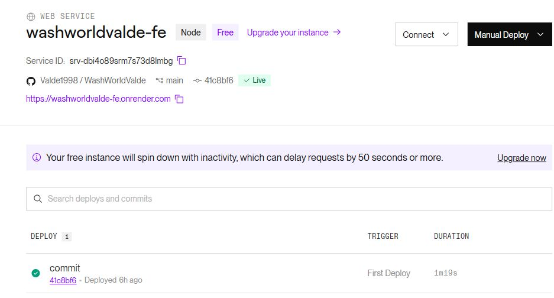
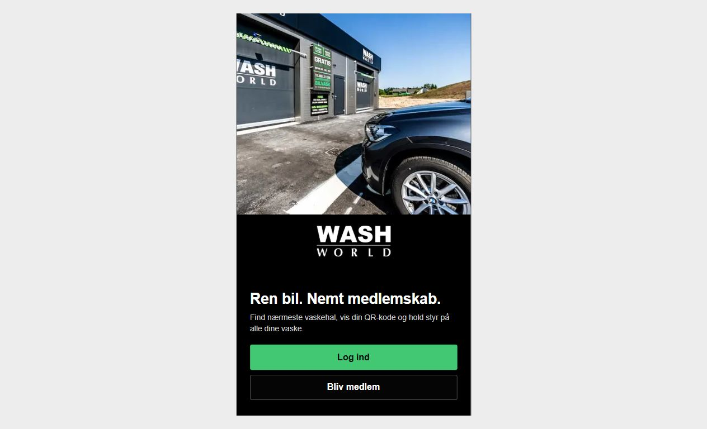

# Deploying the WashWorld frontend on Render

**Deployed and checked: 30 October 2026**

Live site: [washworldvalde-fe.onrender.com](https://washworldvalde-fe.onrender.com)

This guide deploys the Next.js frontend from [WashWorldValde](https://github.com/Valde1998/WashWorldValde). It uses the `main` branch, commit `41c8bf6`. The Flask backend and database are not included. The aim is to put the frontend online and check that its pages load.

The service was created through the Render integration. You can use the same settings in the Render Dashboard by following these steps.

## 1. Create the web service

Sign in to [Render](https://dashboard.render.com), select your workspace (**EK** was used here) and choose **New → Web Service**. Connect the GitHub repository `Valde1998/WashWorldValde`.

Use these settings:

| Setting | Value |
| --- | --- |
| Name | `washworldvalde-fe` |
| Branch | `main` |
| Language / runtime | Node |
| Region | Frankfurt |
| Instance type | Free |
| Root directory | Leave empty |
| Auto-deploy | Off |

If creating another copy, choose a different service name. The public URL will then be different.

Set the build command to:

```sh
cd frontend && npm ci --include=dev && npm run build
```

Set the start command to:

```sh
cd frontend && npm start -- -H 0.0.0.0 -p $PORT
```

Both commands start in the repository root and enter `frontend`. `npm ci` installs the versions in the lockfile. Development dependencies are included because the build needs TypeScript. `npm run build` creates the production files, and `npm start` runs the Next.js server. `0.0.0.0` allows Render to reach it, and `$PORT` uses Render's assigned port.

This follows Render's [Node web service approach for Next.js](https://render.com/docs/deploy-nextjs-app).

## 2. Add environment variables

| Name | Value |
| --- | --- |
| `NODE_VERSION` | `24.14.0` |
| `CYPRESS_INSTALL_BINARY` | `0` |
| `NEXT_TELEMETRY_DISABLED` | `1` |
| `NEXT_PUBLIC_API_URL` | Empty value |

The Cypress setting skips an unnecessary browser-test download. The telemetry setting disables Next.js usage reporting. No passwords or database settings are needed for this frontend deployment.

Keep `NEXT_PUBLIC_API_URL` present with an empty value; do not type quotation marks. This sends API requests to the same website instead of a visitor's localhost. There is no Flask API at that address, so data features remain unavailable. A real backend URL would need to be set before rebuilding.

## 3. Deploy and open the site

Click **Deploy Web Service** and follow the build log. Wait until the service is **Live**, then open its HTTPS URL. With auto-deploy off, later updates require a manual deployment.





## 4. Check the result

The local production build passed. The live site returned HTTP 200 with the title **WashWorld**. These browser checks also passed:

- The welcome page displayed its logo and images.
- **Log ind** opened `/login`, including after reloading that URL directly.
- Submitting the empty login form showed **Indtast en gyldig emailadresse.**
- Opening `/hjem` without a session redirected to `/login`.

The pages and navigation work. Login, registration, memberships and saved data do not work yet because the backend and database are not deployed. The login check above only tests the form's input validation.

On Render Free, the service sleeps after 15 minutes without traffic. The next visit can take about a minute to wake it. See [Render's free service limitations](https://render.com/docs/free).

## Use of AI

OpenAI Codex was used to configure and test the Render deployment and write this tutorial. The technical instructions refer to the Render documentation linked above.

Reference: OpenAI (2026). Codex, AI coding assistant. Used 30 October 2026.
